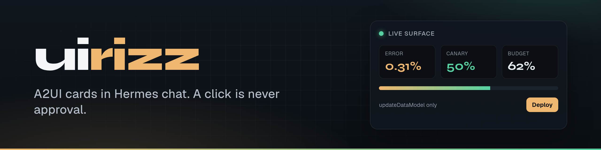
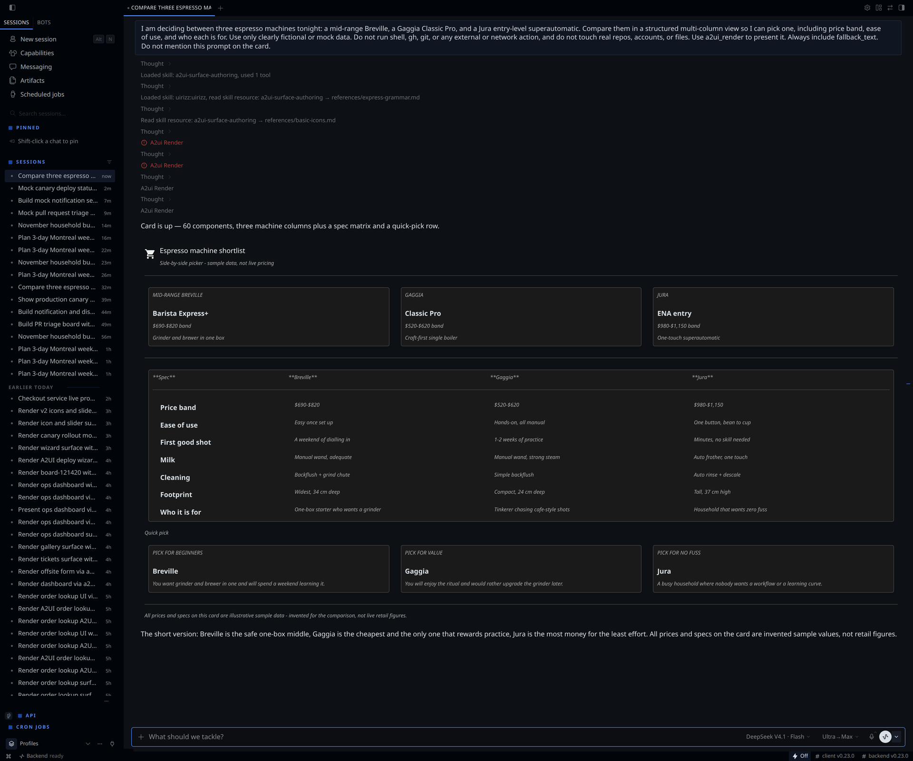
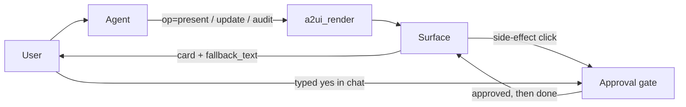
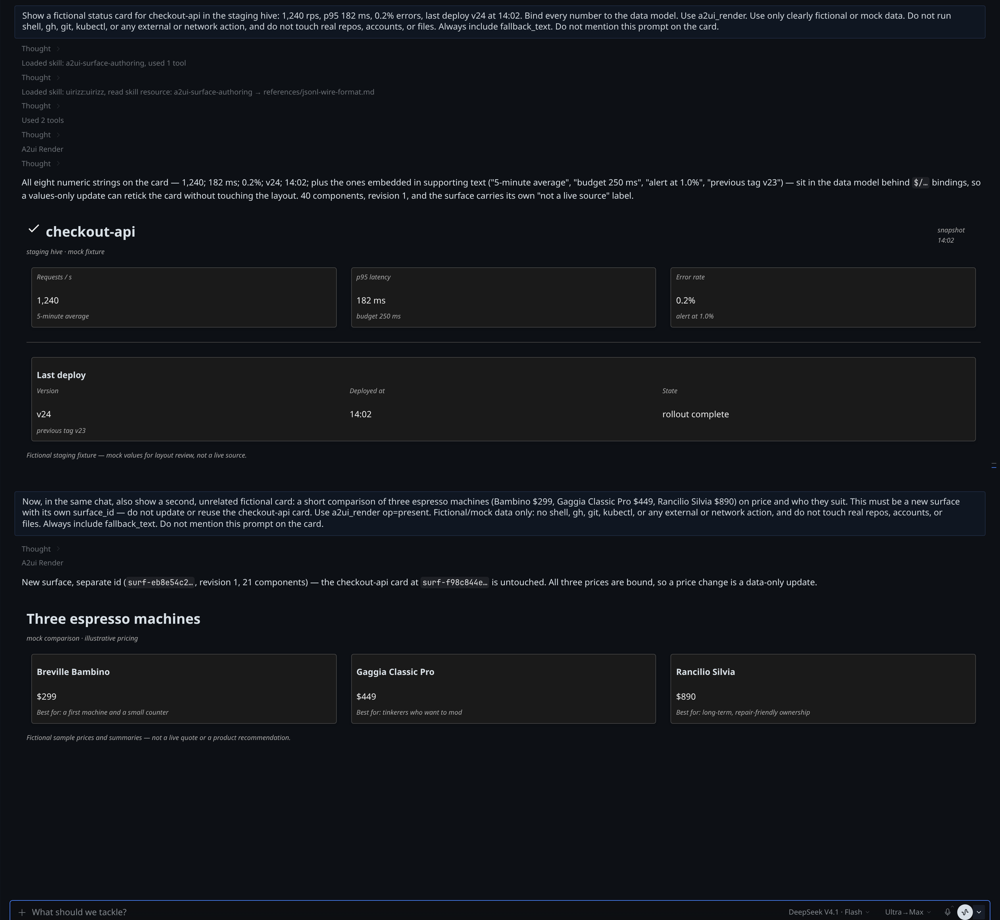
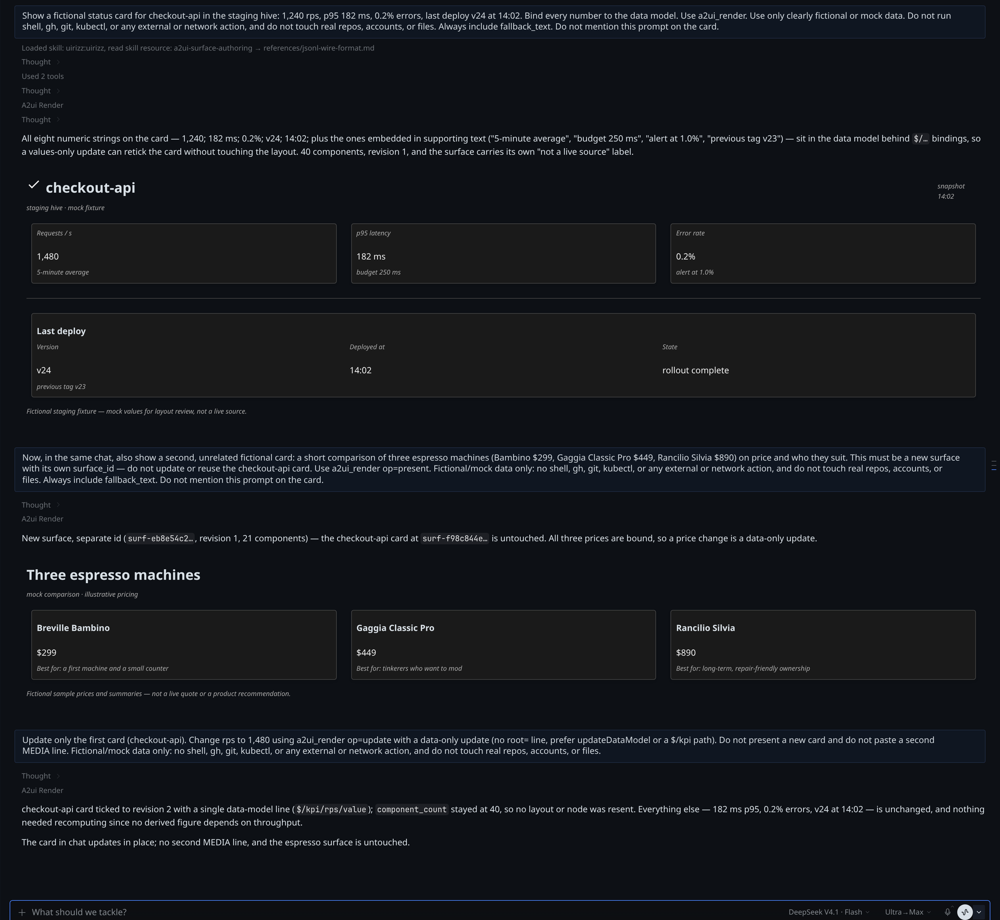
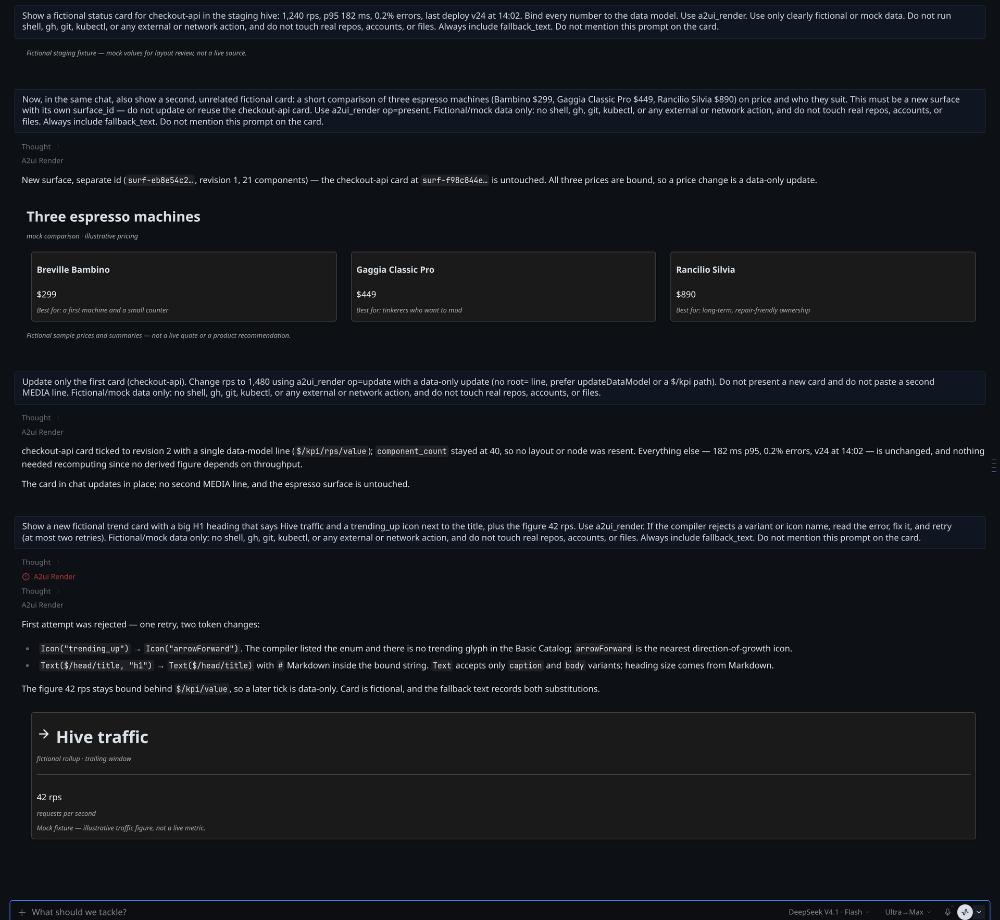
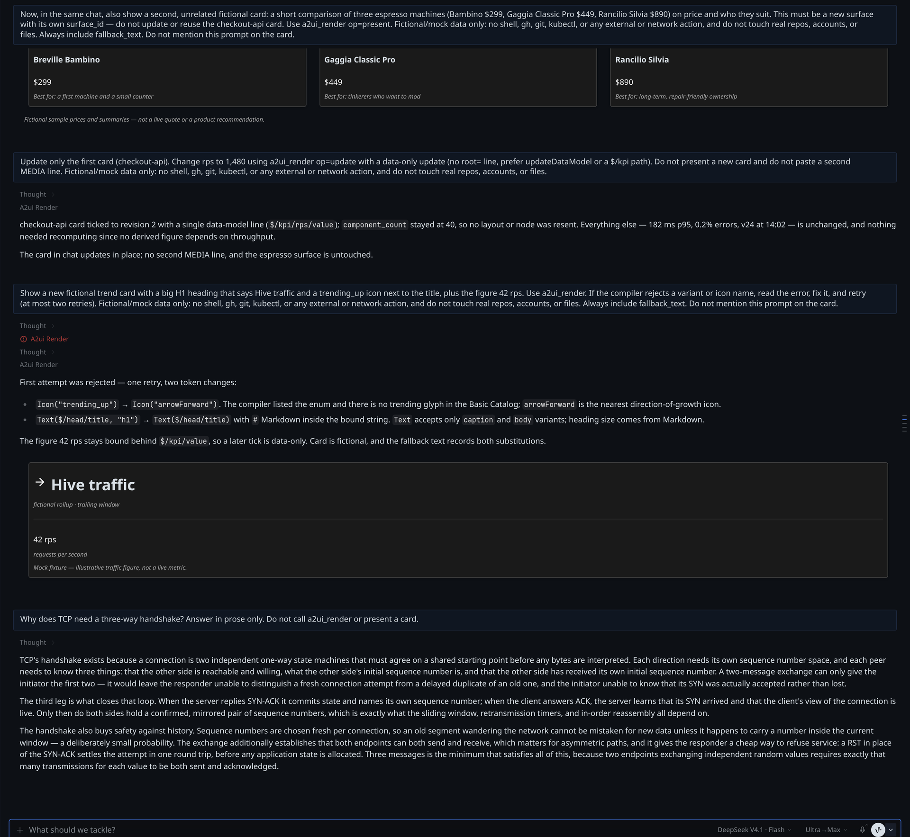
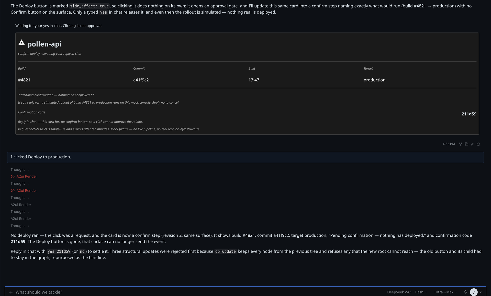
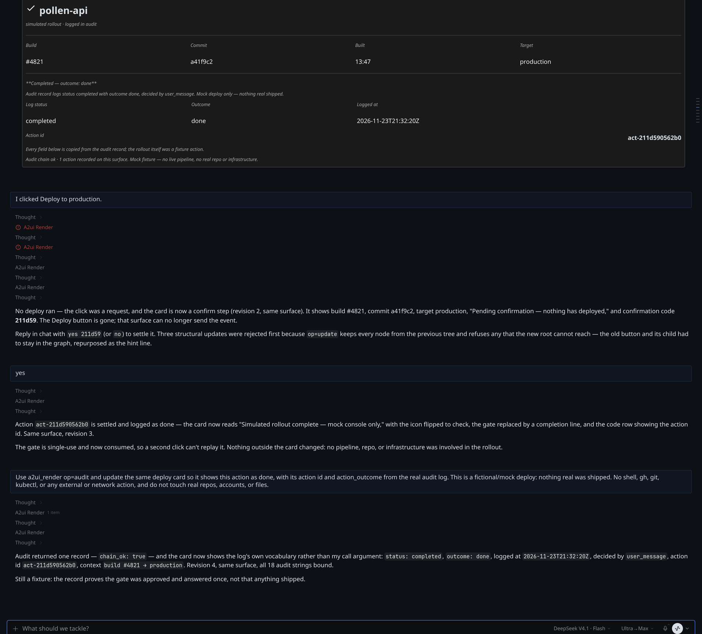

# uirizz

[](https://github.com/mojomast/uirizz/actions/workflows/ci.yml)
[](LICENSE)
[](CHANGELOG.md)

<p align="center">
  
</p>

**A2UI v1.0 Basic Catalog cards in Hermes Desktop and Webapp chat — with a typed-yes approval gate and CLI fallback text.**



## Why uirizz

When a form, status board, or comparison is clearer than a wall of prose, the agent should draw a card in the chat — and a button click must never silently ship, send, or delete anything.

uirizz is a native [Hermes](https://github.com/NousResearch/hermes-agent) plugin that renders official [A2UI](https://a2ui.org/specification/v1.0-a2ui/) v1.0 Basic Catalog surfaces with one tool, `a2ui_render`. Desktop and Webapp mount the official `@a2ui/react` widgets (Night Hive, always dark). CLI, Telegram, and the classic dashboard TUI show the required `fallback_text`. Live updates reuse a stable `surface_id`. Side effects wait for a typed `yes` in chat.

It does **not** register `transform_llm_output`, so it can sit beside hermes-a2ui. It is **not** in the Hermes plugin catalog yet.

## Quickstart

1. **Install, pinned to a full 40-character commit** (tags, branches, and short SHAs are rejected):

   ```bash
   hermes plugins install mojomast/uirizz --ref <40-character-sha> --enable
   ```

   Or from a checkout: `hermes plugins install /path/to/uirizz --enable`.

2. **Check the load:**

   ```bash
   hermes plugins doctor uirizz --ci
   ```

3. **Ask for a card.** Skill id: `uirizz:uirizz` (no `plugin:` prefix). In chat: “Show this as a card.” The agent should call `a2ui_render` and paste the `MEDIA:` line into its reply.

To move a pin: `hermes plugins install mojomast/uirizz --force --ref <new-40-character-sha>`. The same pin is in Desktop under **Skills → Plugins → Install from Git**. Catalog install is not available yet.

Requires Hermes **0.23.0** or newer and Python 3.10+.

## How it works

The agent calls `a2ui_render`. The plugin admits official catalog components, stores the surface, and returns a `MEDIA:` line plus `fallback_text`. A later `op=update` with `updateDataModel` changes values without redrawing the layout. A side-effect click is only a request; the user types `yes` in chat before anything is marked done.

The shots below are from one Hermes Webapp chat in dark mode (mock/fictional data only) after the authoring fixes landed on `main`.



1. **Two cards, distinct ids.** A status card and a second, unrelated comparison card both present in the same chat. Express no longer reuses the compiler default id `main`.

   

2. **Live data-only update, in place.** The first card's rps changes from 1,240 to 1,480 on the same `surface_id` (revision 2). In this session the host refreshed the mounted card and a duplicate did not appear.

   

3. **Compiler recovery.** A prompt that tempts `Text(..., "h1")` and `Icon("trending_up")` is rejected once; the agent retries with allowed variants and a camelCase icon, and the card renders.

   

4. **Plain question, no card.** "Why does TCP need a three-way handshake?" is answered in prose; no new surface is created.

   

5. **Side-effect click → pending, then typed yes → done.** The Deploy button is a request, not approval. The confirm step has no Confirm button. After `yes`, `op=audit` shows `outcome: done`.

   

   

6. **CLI fallback.** Clients without a card renderer show `fallback_text` instead.

   

## Ops reference

| Op | Purpose |
|---|---|
| `present` | Create a surface. Optional `surface_id` (minted if omitted). Requires `fallback_text` and either `express` (preferred) or `jsonl`. |
| `update` | Patch the same `surface_id`. Express is compiled against the stored surface, so `$/kpi/rps = 42` alone becomes an `updateDataModel`. |
| `delete` | Remove a `surface_id`. |
| `describe` | Catalog, limits, media policy, and the approval-gate contract. `topic=recipes` returns tested Express recipes; `topic=express` the cheat sheet; `topic=actions` the declared actions. |
| `audit` | Recent entries from the hash-chained action log. |

After a successful `present`, copy the `MEDIA:` line from the tool result, alone on its own line, into the model reply. After an `update` the mounted card refreshes itself, and the model is told not to paste the line again. Compile errors carry the Express compiler's own message (line, column, allowed values) so the model can fix the exact line.

## Approval and security

A card click is a **request, never approval**.

- Classification is **fail-closed**. A click needs confirmation unless the action context says `read_only: true` and nothing points at a side effect. Verbs such as deploy, merge, send, and delete always gate.
- Approval is the user's own short typed `yes <code>` in chat, after the pending notice, **single-use**, **session-scoped**, and **600 seconds** TTL. A bare `yes` is accepted only for a lone `risk: low` declared action; medium, high and free-form side effects need the code.
- While pending, `pre_tool_call` vetoes every tool except `a2ui_render` and a few read-only helpers.
- `uirizz verify --anchors FILE` recomputes the hash-chained log against `rizzstack.audit-anchor/1` anchors kept outside uirizz, and fails on a re-hashed rewrite, truncation or a missing anchor.
- Read-only clicks reach the agent from the audit log on disk, once each, at most 20 per turn and only within 10 minutes. Their context is the log's sanitized copy: strings are capped at 200 characters and secret-looking keys are redacted.
- `op=update` with `action_outcome=done` or `failed` is rejected until that action is approved.
- The log is append-only and hash-chained under the plugin data directory (`audit/actions.jsonl`). Every read-decide-write step holds a cross-process lock, and rotation at 5 MB carries open actions and rate-limit state into the new file.

What it is not: the gate stops the model from treating a click as approval; it is not a boundary against a compromised agent or anyone with shell access on the host. After a typed yes on a **free-form** click, shell, exec and code tools stay blocked unless a declared action covers the call, but other tools aren't limited (declared actions limit everything). `POST /actions` trusts the `session_id` it is sent, and `auto_approve` lets that click alone approve a low-risk declared action. The audit chain has no secret key, so it catches accidental edits, not deliberate rewrites. Details: [docs/ACTIONS.md](docs/ACTIONS.md#what-the-gate-is-and-what-it-is-not).

The plugin declares no credentials and no `requires_env`. It starts no runtime subprocesses. Media must be public `https` (no `http`, `data:`, or local files). Surface records live in the Hermes plugin data directory, not the install checkout. The Desktop half uses only `@hermes/plugin-sdk` and `ctx.rest`. The gate cannot see what a tool does outside Hermes, and card text is still model-authored.

## Declared actions

Wire a card button to a real tool with a few lines of config. A declared
action binds a click to **one exact Hermes tool call**: params are validated,
uirizz draws its own confirm panel, the user's typed yes (`yes <code>` unless
the action is `risk: low`) approves that call only, `pre_tool_call` lets it run once, and
`post_tool_call` records the outcome.

```yaml
# ~/.hermes/plugin-data/uirizz/actions.yaml
actions:
  deploy_service:
    title: "Deploy {service} {version} to {env}"
    tool: mcp_github_dispatch_workflow
    args: {repo: "acme/{service}", inputs: {version: "{version}", env: "{env}"}}
    params:
      service: {type: string, enum: [checkout-api, search-api]}
      version: {type: string, pattern: "^v[0-9]+$"}
      env: {type: string, enum: [staging, production]}
    risk: high
```

Risk tiers (`low` with optional `auto_approve`, `medium`, `high`), per-hour
limits, replay and argument-tampering protection, and a plugin API are covered
in [docs/ACTIONS.md](docs/ACTIONS.md). Validate a file with
`python -m uirizz_plugin.bindings check`.

## Data components (uirizz/1)

uirizz extends the Basic Catalog with nine data components, so the agent answers "show me the trend" with a chart instead of prose:

| Component | For |
|---|---|
| `Chart` | line, area, bar, stacked bar, horizontal bar, scatter, pie, donut (ECharts, SVG renderer, plain-text tooltips, a "View as table" toggle) |
| `DataTable` | sortable, paged rows with per-column formats |
| `Metric` | a headline number with delta, trend and optional sparkline |
| `Progress`, `Badge`, `Callout` | completion, a status word, a highlighted note |
| `KeyValueList`, `Timeline`, `CodeBlock` | label/value pairs, dated events, code or logs |

Charts and tables are inputs too: `selection=$/ui/row` writes the clicked row into the data model, and the button's action sends it, for example `Event("drill", {row: $/ui/row, read_only: true})`. The contract is [uirizz_components.json](uirizz_plugin/catalogs/uirizz_components.json); `python scripts/build_catalog.py` rebuilds the merged catalog, and CI fails if it is stale. The agent gets signatures and tested examples from `op=describe topic=components`.

Cards now update over a push socket (with adaptive polling as a fallback), collapse older copies of the same surface ("highest revision wins"), and can open in a Desktop workspace tab ("Open in canvas"). `fallback_text` is generated from the components when the agent omits it.

## Layout tips

Compose wide: wrap the surface in a `Column` and give `Row`/`Column` children a `weight`. KPI row: 3–5 `Card`s at `weight=1`. Master/detail: `2:3`. Prefer `updateDataModel` after the first `present`. The bundled skill (`uirizz:uirizz`) links [tested recipes](skills/uirizz/references/recipes.md), an [Express cheat sheet](skills/uirizz/references/express.md), and a [worked layout](skills/uirizz/references/layout.md); CI compiles every example.


## Limits and known issues

Basic Catalog v1.0 (Text, Image, Icon, Row, Column, List, Card, Tabs, Divider, Modal, Button, TextField, CheckBox, ChoicePicker, Slider, DateTimeInput) plus the nine uirizz/1 components above. No Video, AudioPlayer, or `openUrl`. Caps: **256 KiB** payload, **100** components, 500 rows in a literal Chart/DataTable array, 5,000 items in any data-model array. No Map or Markdown block.

Observed issues, listed honestly:

- **Images not loading** — even public `https` URLs often do not render. Omit the image and say so in `fallback_text`.
- **View buttons wrapping** in official widgets at typical card widths.
- **Tall cards** now scroll inside a 480 px card; use **Open in canvas** for dashboards.
- **Re-presenting instead of `update`** still creates a new surface if the model calls `present` again for the same view. Presenting a *new* unrelated card without `surface_id` now succeeds with a distinct id (it no longer collides on `main`).
- **Duplicate surface copies:** a second `MEDIA:` line for the same surface now collapses the older card to a one-line "Updated below" stub (highest revision wins). Not yet verified live.

## Development

```bash
python -m pip install -e ".[dev]"
python -m pytest -q
cd desktop && npm ci && npm test && npm run check-bundle
hermes plugins doctor . --ci
hermes plugins validate . --install-deps
python scripts/measure_tokens.py
```

Token budgets (enforced in `tests/test_tokens.py`):

- Skill (`skills/uirizz/SKILL.md`): under **2,000** o200k tokens.
- Tool schema: under **500** o200k tokens.

Changes land through pull requests that need the required `ci-gate` check. Agent GitHub work is moving off the owner's account: the coordinator will open, update and merge PRs and rerun CI as the `rizzstack-coordinator[bot]` GitHub App, outside reviews will be posted as `rizzstack-reviewer[bot]`, and owner approvals and release yeses stay with the owner's own account. Live migration status: [policy/identities.md](https://github.com/mojomast/rizzstack/blob/main/policy/identities.md) in rizzstack. Setup: [rizzstack docs/github-apps.md](https://github.com/mojomast/rizzstack/blob/main/docs/github-apps.md). Gating reviews by bot login is planned, not yet enforced. uirizz itself makes no GitHub calls.

`plugin.yaml` version is the source of truth. Bump with `python scripts/bump_plugin_version.py <new-version>`.

## Changelog and license

See [CHANGELOG.md](CHANGELOG.md) for the 0.1.0 line.

MIT. See [LICENSE](LICENSE). A2UI is a separate project under Apache License 2.0. This repository does not copy hermes-a2ui source; that project is also MIT-licensed, and is cited only as prior art in [docs/RESEARCH.md](docs/RESEARCH.md).
