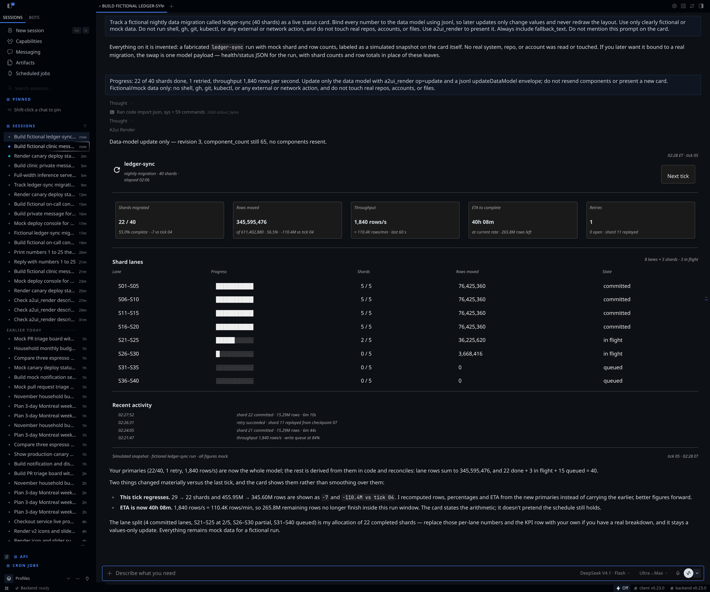
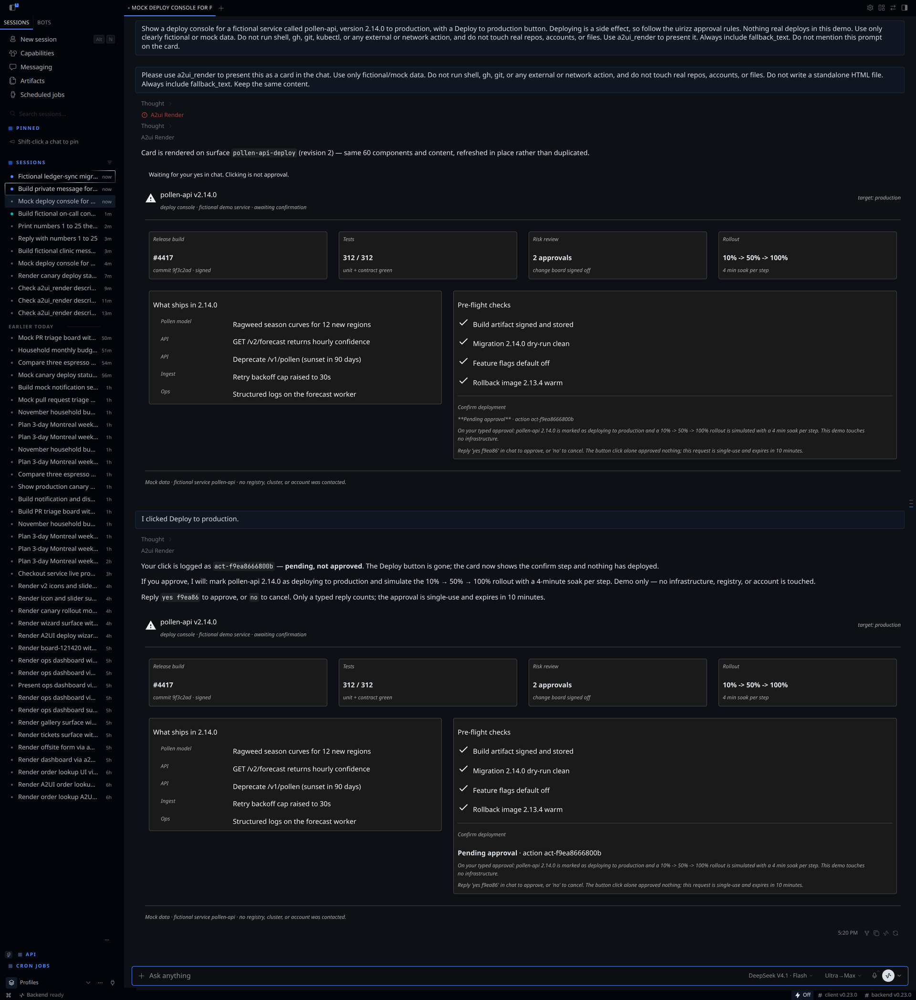
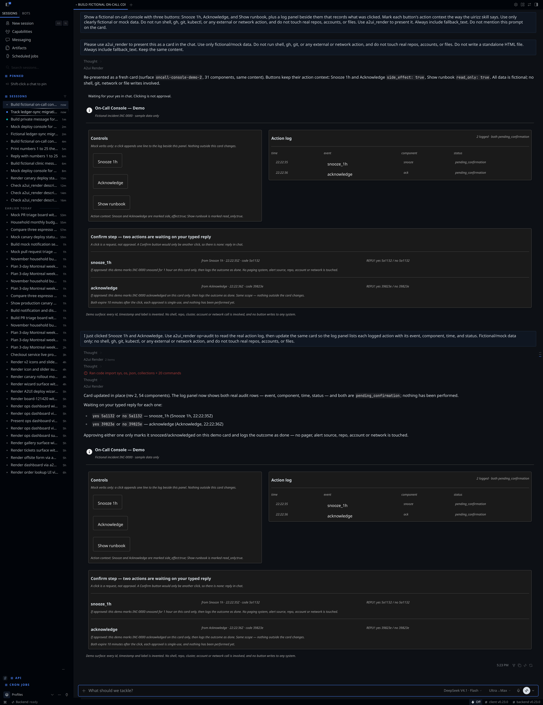
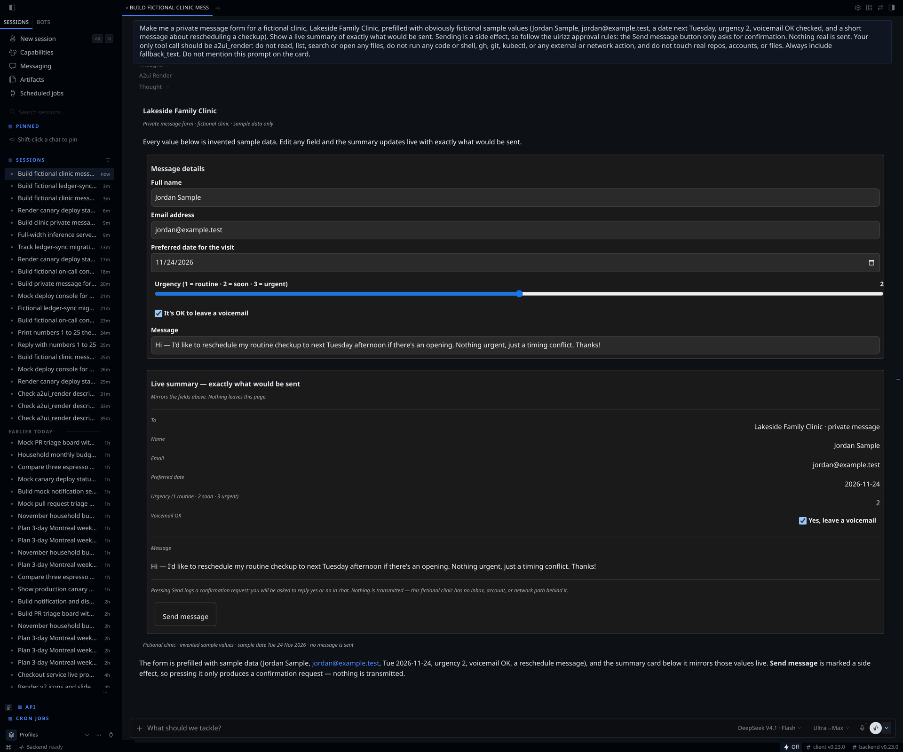

# uirizz

A native [Hermes](https://github.com/NousResearch/hermes-agent) plugin that
renders [A2UI](https://a2ui.org/specification/v1.0-a2ui/) v1.0 **Basic Catalog**
cards in Hermes Desktop and Webapp chat. The agent calls one tool,
`a2ui_render`; the plugin admits official catalog components, stores the
surface under a stable `surface_id`, and returns a `MEDIA:` line plus required
`fallback_text`. Desktop and Webapp draw the official `@a2ui/react` widgets
(Night Hive, always dark). CLI, Telegram, and the classic dashboard TUI show
only the fallback text.

It does **not** register `transform_llm_output`, so it can be installed beside
hermes-a2ui without fighting over that hook. It is **not** in the Hermes plugin
catalog yet.


## Requirements

- Hermes **0.23.0** or newer (`requires_hermes: ">=0.23.0"`), for
  `TOOL_MEDIA_RENDERER_AREA` and Desktop `ctx.rest`.
- Python 3.10 or newer.

## Install

From a local checkout:

```bash
hermes plugins install /path/to/uirizz --enable
hermes plugins doctor uirizz --ci
```

For a reproducible install, pin a **full 40-character commit**. Tags, branches,
and abbreviated SHAs are rejected. Hermes checks out the commit detached,
verifies that `HEAD` matches the requested SHA, and records the pin in the
current profile. `hermes plugins update` will not move a pinned plugin.

```bash
hermes plugins install mojomast/uirizz --ref <40-character-sha> --enable
```

To move the pin to a new commit:

```bash
hermes plugins install mojomast/uirizz --force --ref <new-40-character-sha>
```

The same pin is available in Hermes Desktop under **Skills → Plugins → Install
from Git**, in the *Pin to commit* field. `hermes plugins list` shows
`pinned @ <sha8>` in the Source column.

Catalog install (`hermes plugins install uirizz`) is not available yet. Do not
submit a catalog PR without an explicit yes from the maintainer.

Skill id: `uirizz:uirizz`. Pass that exact string to `skill_view` (no
`plugin:` prefix).

## Tool: `a2ui_render`

| Op | Purpose |
|---|---|
| `present` | Create a surface. Optional `surface_id` (a new id is minted if omitted). Requires `fallback_text` and either `express` (preferred) or `jsonl` (raw A2UI v1.0, one envelope per line). |
| `update` | Patch the same `surface_id` in place. Prefer a data-model-only `updateDataModel` payload so values change and the layout is not redrawn. |
| `delete` | Remove a `surface_id`. |
| `describe` | Report the catalog, payload limits, media policy, and approval-gate contract. |
| `audit` | Return recent entries from the hash-chained action log (optional `surface_id`, `limit`). |

`fallback_text` is required on `present`. It is the copy a CLI or messaging
user reads when there is no card renderer. After a successful call, copy the
`MEDIA:` line from the tool result, alone on its own line, into the model
reply — Desktop and Webapp mount the card from that line.


Media URLs must be public `https` only. The plugin will not read model-chosen
local files and will not accept `http` or `data:` image URLs (including SVG).

Live updates reuse the same `surface_id`. Change numbers with `op=update` and
an `updateDataModel` envelope; do not present a second card for the same view.



## Approval gate and audit log

A card click is a **request, never approval**. Nothing a button does is
authorized until the user types an explicit yes in chat.

- The gate classifies each click **fail-closed**. A click needs confirmation
  unless the action context says `read_only: true` and nothing in the event
  name, context, or stored surface points at a side effect. Verbs such as
  deploy, merge, send, and delete always gate.
- A gated click is stored as `pending_confirmation`. Only the user's own short
  typed `yes` (or a close synonym), after the pending notice was shown, moves
  it to `approved`.
- Approval is **single-use**, **session-scoped**, and expires after **600
  seconds**.
- While an action is pending, `pre_tool_call` vetoes every tool except
  `a2ui_render` and a few read-only helpers (`skill_view`, `tool_search`, and
  similar).
- `op=update` with `action_outcome=done` or `failed` is rejected unless that
  action is already approved.
- Every click is appended to a hash-chained audit log in the plugin data
  directory (`audit/actions.jsonl`). Read it with `op=audit` or
  `GET /audit`.
- The card shows status from the server, never from the click itself.

Limits: the gate cannot see what a tool does outside Hermes, and the card text
is still model-authored. Demo side effects in this repository are fictional;
a click still must not be treated as approval.





## Layout guidance

Compose wide: wrap the surface in a `Column` and split content with `Row` or
`Column` children that carry `weight` (a flex-grow ratio; the Basic Catalog
has no grid). Give children weights so the card fills its width instead of
one narrow stacked column.

- KPI row: a `Row` of 3–5 `Card`s, each `weight=1`, with a caption over the value.
- Master/detail: left `Column` or `Card` at `weight=2`, right at `weight=3`.
- `Tabs` for alternate views of the same object; `Modal` for a short confirm;
  `List` with `_template($/items, rowTemplate)` for repeats.
- `Icon` takes Material icon names; the card bundles the icon font.
- `Slider` `steps` is the number of discrete divisions, not the unit
  increment. Omit `steps` for a continuous slider.

A private form can bind fields to a live summary on the same card, and treat
Send as a gated side effect:



Best-practice research, with sources, is in [docs/RESEARCH.md](docs/RESEARCH.md).

## Basic Catalog limits

Official Basic Catalog v1.0 only (`catalogId`
`https://a2ui.org/specification/v1_0/catalogs/basic/catalog.json`).

Allowed components: Text, Image, Icon, Row, Column, List, Card, Tabs, Divider,
Modal, Button, TextField, CheckBox, ChoicePicker, Slider, DateTimeInput.

Do not use Video, AudioPlayer, or `openUrl`. Do not invent custom component
types. Protocol version is `1.0` only.

Caps: **256 KiB** payload, **100** components.

The catalog has no Chart, Table, Progress, Badge, Map, Markdown block, or
conditional visibility. A read-only `Slider` can stand in for a progress bar;
do not fake the missing types with raw HTML.

## Known issues

These are current, observed limitations — not a roadmap:

- **Images not loading.** Even public `https` image URLs often do not render
  in the card. If an image cannot be shown, omit it and say so in
  `fallback_text`.
- **View buttons wrapping.** Some button rows wrap awkwardly in the official
  widgets at typical card widths.
- **Duplicate surface copies on update.** An `op=update` can leave a second
  copy of the card in the thread instead of refreshing the existing one in
  place.
- **Tall cards clipping.** A long card can sit under the composer or get
  clipped in the chat viewport.
- **Re-present creating a new revision.** If the model calls `present` again
  instead of `update` on the same `surface_id`, a new revision (and often a
  new card) is created. Prefer `update`, and teach that in the skill.

## Development and tests

```bash
python -m pip install -e ".[dev]"
python -m pytest -q
cd desktop && npm ci && npm test && npm run check-bundle
# if a local Hermes 0.23+ is on PATH:
hermes plugins doctor . --ci
hermes plugins validate . --install-deps
```

Token budgets are enforced in `tests/test_tokens.py` and measured with
`python scripts/measure_tokens.py`:

- Skill (`skills/uirizz/SKILL.md`): under **2,000** o200k tokens.
- Tool schema (`A2UI_RENDER_SCHEMA`): under **500** o200k tokens.

`plugin.yaml` version is the source of truth (currently `0.1.0`). Bump it with
`python scripts/bump_plugin_version.py <new-version>`, which also updates
`pyproject.toml` and `uirizz_plugin/__init__.py` and refuses duplicate YAML
keys.

## Security notes

- No credentials and no `requires_env`.
- No subprocesses at runtime.
- No network from the plugin except loading an already-admitted public https
  image through the host.
- Surface records and the audit log live in the Hermes plugin data directory,
  not in the install checkout.
- The Desktop half uses only `@hermes/plugin-sdk` and `ctx.rest`. It does not
  patch the host, eval code, or load React from a CDN.
- The classic Hermes dashboard chat page is a terminal. This plugin cannot
  draw in-message widgets there.
- A click is never approval; see [Approval gate and audit log](#approval-gate-and-audit-log).
- Labels and values on a surface are data, not instructions.

## License

MIT. See [LICENSE](LICENSE). A2UI is a separate project under Apache License
2.0. This repository does not copy hermes-a2ui source; that project is also
MIT-licensed, and is cited only as prior art in the research notes.
